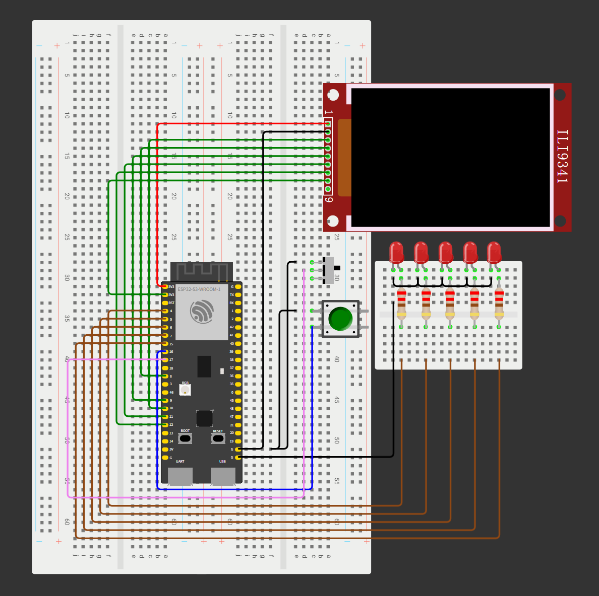
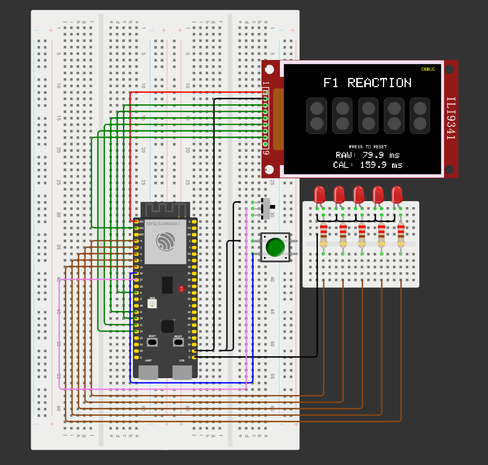

# ESP32 F1 Reaction Game

**English** | [简体中文](README.zh-CN.md)

**An F1-inspired reaction game built with ESP32-S3, an ILI9341 TFT display, and five external red LEDs.**

Start a round, watch the lights build up, and press the button as soon as the external LEDs go out. The game measures your response, detects false starts, and keeps the result on screen until you reset it.

[Run the Wokwi project](https://wokwi.com/projects/479746846531493889) · [Hardware notes](docs/hardware-notes.md) · [Reference documents](docs/references.md)

**Status:** The latest code changes passed user-reported functional testing. The exact test environment and dependency versions have not yet been recorded. Independent physical timing calibration remains pending.

## Preview

### Circuit



### Gameplay



These images illustrate the project; they may predate the latest on-screen hints. Before running the linked simulation, check that its sketch matches this repository's current `sketch.ino`.

## Features

- Five GPIO-controlled external LEDs with an 800 ms lighting interval
- Randomized 1–3 second wait after the fifth LED illuminates
- 320 × 240 TFT interface with five two-row lamp boxes; the upper row stays gray
- Interrupt-timestamped button presses and raw reaction times in milliseconds
- False-start detection and a 10-second reaction deadline
- Debug and Normal modes, locked for each round
- Button-release debounce that tracks edges while the display is being updated
- Explicit start, reaction, and reset actions using one button
- Configurable timing compensation and serial output at 115200 baud
- Partial display refresh on reset to reduce full-screen flicker

## How to Play

1. Select **Debug** or **Normal** using the slide switch. Let the switch settle before starting.
2. Release the button, then press it to start a round.
3. Release the button and wait while the five external red LEDs illuminate one by one.
4. After all five are on, keep waiting through the random delay.
5. **Watch the external LEDs. Press the button as soon as they go out.**
6. Read your result, then release the button and press again to reset.
7. Press once more to start the next round.

The external LEDs are the timing reference. The TFT lamps and `GO!` message update afterward over SPI, so reacting to the screen instead can add display latency to the measurement. The screen includes a `WATCH PHYSICAL LEDS` reminder.

| Outcome | Meaning | Next action |
|---|---|---|
| Reaction time | An accepted press occurred before the 10-second deadline | Release, then press to reset |
| `FALSE START!` | A press was detected before lights-out, or the button was held at lights-out | Release, then press to reset |
| `TIMEOUT!` | No accepted reaction occurred before the deadline; exactly 10 seconds also counts as timeout | Release, then press to reset |

The game never resets or starts another round automatically. After a result page or reset finishes drawing, the button must remain released for at least 30 ms before another press is accepted. Presses during result-page rendering are discarded; holding the button does not repeatedly activate controls. At startup, release a held button before trying to start.

## Operating Modes

| Mode | Switch input | Display behavior |
|---|---|---|
| Debug | GPIO17 LOW | Updates `RAW` and `CAL` approximately every 100 ms during the reaction phase, then holds both final values |
| Normal | GPIO17 HIGH | Hides the live timer and shows the compensated result after a valid press |

`RAW` is the timestamp difference without compensation. `CAL` is the compensated value. Moving the switch during a round does not change that round's mode; reset before starting with the new selection.

## Hardware and Wiring

The simulation uses an ESP32-S3-DevKitC-1. The planned physical board is a vendor-supplied N16R8 variant, nominally 16 MB Flash and 8 MB PSRAM; verify its markings, revision, pinout, and configuration before use.

| Component | Quantity |
|---|---:|
| ESP32-S3 development board | 1 |
| ILI9341 2.8-inch SPI TFT module | 1 |
| Red LEDs | 5 |
| 220 Ω LED series resistors | 5 |
| Momentary push button | 1 |
| Slide switch | 1 |
| Breadboards, jumper wires, and USB cable | As needed |

### TFT Display

| TFT pin | ESP32-S3 connection |
|---|---|
| VCC | 3V3 in the simulation |
| GND | GND |
| CS | GPIO10 |
| RST | GPIO8 |
| D/C | GPIO9 |
| MOSI | GPIO11 |
| SCK | GPIO12 |
| LED / Backlight | 3V3 in the simulation |
| MISO | Not used |

For a physical module, check its supply requirements, backlight current, regulator, and solder-jumper configuration against the matching module documentation. The simulation's supply wiring is not a substitute for checking the actual board.

### External LEDs

| LED | GPIO | Series resistor |
|---|---|---|
| 1 | GPIO4 | 220 Ω |
| 2 | GPIO5 | 220 Ω |
| 3 | GPIO6 | 220 Ω |
| 4 | GPIO7 | 220 Ω |
| 5 | GPIO15 | 220 Ω |

Each LED has its own series resistor. Connect the LED cathodes to the common ground.

### Button and Mode Switch

| Control | Connection |
|---|---|
| Reaction button | GPIO16 to GND when pressed |
| Mode switch | Common terminal to GPIO17, one side to GND; leave the other side unconnected |

Both inputs use internal pull-ups. Use a common ground for the development board, display, and controls.

## Running the Project

### Wokwi

1. Open the [simulation](https://wokwi.com/projects/479746846531493889).
2. Compare the online sketch with this repository and update it if necessary. Local Git changes do not automatically update the linked Wokwi project.
3. Start the simulation, select a mode, and follow the gameplay steps above.
4. Watch the five external simulated LEDs for the start signal.

`diagram.json` contains the circuit connections. `libraries.txt` lists the display-library dependencies.

### Physical ESP32-S3

1. Install Arduino IDE with the Espressif ESP32 board package.
2. Install **Adafruit GFX Library** and **Adafruit ILI9341**, including their required dependencies.
3. Place `sketch.ino` in an Arduino sketch folder with a matching name, or let Arduino IDE create the matching folder when opening it.
4. Select the board and Flash/PSRAM settings that match the actual module, then select its USB port.
5. Verify the wiring, supply, and display module settings before powering the circuit.
6. Compile and upload the sketch. Open the serial monitor at **115200 baud** to inspect successful results, false starts, and timeouts.
7. Record the board-package and library versions used for a successful build. Calibrate independently before making accuracy claims.

The sketch uses the ESP32 Arduino environment, including its GPIO interrupts and FreeRTOS critical-section primitives. Dependency versions are not currently pinned.

## Timing and Configuration

The program switches off all five external LEDs, then immediately records `lightsOutUs` with `micros()`. The accepted button-press interrupt records `pressTimeUs`. The interval is calculated from those timestamps, rather than from when the main loop finishes updating the display.

```text
raw_ms   = (press_time_us - lights_out_us) / 1000
final_ms = max(0, raw_ms × TIME_MULTIPLIER - FIXED_COMPENSATION_MS)
```

Current settings near the beginning of `sketch.ino`:

| Constant | Value | Purpose |
|---|---|---|
| `TIME_MULTIPLIER` | `1.0f` | Scales the raw interval |
| `FIXED_COMPENSATION_MS` | `-80.0f` | Subtracts an offset; this negative value **adds 80 ms** |
| `LIGHT_INTERVAL_MS` | `800` | Nominal delay before each next LED illuminates |
| `WAIT_MIN_MS` | `1000` | Minimum randomized wait after the fifth LED |
| `WAIT_MAX_MS` | `3000` | Maximum randomized wait, inclusive |
| `REACTION_TIMEOUT_US` | `10000000UL` | Reaction deadline in microseconds |
| `DEBUG_REFRESH_MS` | `100` | Nominal live-timer refresh interval |
| `BUTTON_RELEASE_MS` | `30` | Stable release required before accepting another press |
| `MODE_DEBOUNCE_MS` | `40` | Mode-switch debounce interval |

For example, a raw interval of **200 ms** currently displays **280 ms** as the compensated result. To disable compensation, set `TIME_MULTIPLIER` to `1.0f` and `FIXED_COMPENSATION_MS` to `0.0f`.

The existing offset is an experimental setting, not a measured universal correction for TFT latency. Microsecond timestamps and a one-decimal-place display do not establish equivalent measurement accuracy. Interrupt latency, sequential LED switching, display response, and simulation timing still affect the system; physical calibration requires an independent timing reference.

## Program Structure

| State | Responsibility |
|---|---|
| `ST_IDLE` | Wait for a manual start |
| `ST_LIGHTING` | Illuminate the five LEDs sequentially |
| `ST_WAIT` | Keep the LEDs on through the randomized wait |
| `ST_REACTION` | Accept a timestamped reaction or reach the deadline |
| `ST_RESULT` | Hold the result, false-start message, or timeout until reset |

The `CHANGE` interrupt tracks both press and release edges, including release bounce during TFT drawing. Only the first armed press is retained. The main loop rearms input after a stable release, while a shared critical-section lock protects the event and timestamp data.

At the timeout boundary, an already-recorded press is evaluated using its original timestamp. If no event is pending, input is closed atomically before displaying the timeout. Result-page transitions clear old events and require a fresh stable release before reset.

Only changing screen regions are redrawn on reset; the title, lamp frames, and upper gray lamps remain in place.

## Validation Status

- The latest revision passed user-reported functional testing.
- Supplementary desktop checks passed 32 assertions covering debounce during drawing, held buttons, timeout boundaries, timestamp wraparound, mode locking, and a complete round. These checks used simulated hardware interfaces and do not replace an ESP32-target build or physical measurements.
- The user's exact test platform, board revision, dependency versions, and independent calibration measurements are not yet documented.

Useful checks when changing the sketch include an early press, a held button through lights-out, repeated release bounce, both operating modes, a press just before the deadline, a timeout followed by reset, and repeated complete rounds.

## Repository Layout

```text
ESP32-F1-Reaction-Game/
├── sketch.ino
├── diagram.json
├── libraries.txt
├── wokwi-project.txt
├── README.md
├── README.zh-CN.md
├── LICENSE
├── images/
│   ├── circuit.png
│   └── gameplay.png
└── docs/
    ├── hardware-notes.md
    └── references.md
```

[Hardware notes](docs/hardware-notes.md) contain the wiring record and outstanding physical checks. [Reference documents](docs/references.md) link to upstream board, panel, and controller documentation. Vendor PDF bundles and software installers are not redistributed in the current tree; previous commits may still contain older materials.

## Further Work

- Record a reproducible ESP32 build environment and detailed test results
- Measure and calibrate physical input and visual-signal timing
- Refresh screenshots to match the latest interface
- Add best-time tracking and multi-round statistics
- Explore additional display optimizations and a physical enclosure

## License

Original project code and documentation are released under the [MIT License](LICENSE). Third-party libraries, datasheets, tools, and other referenced materials retain their respective licenses and copyright notices.
