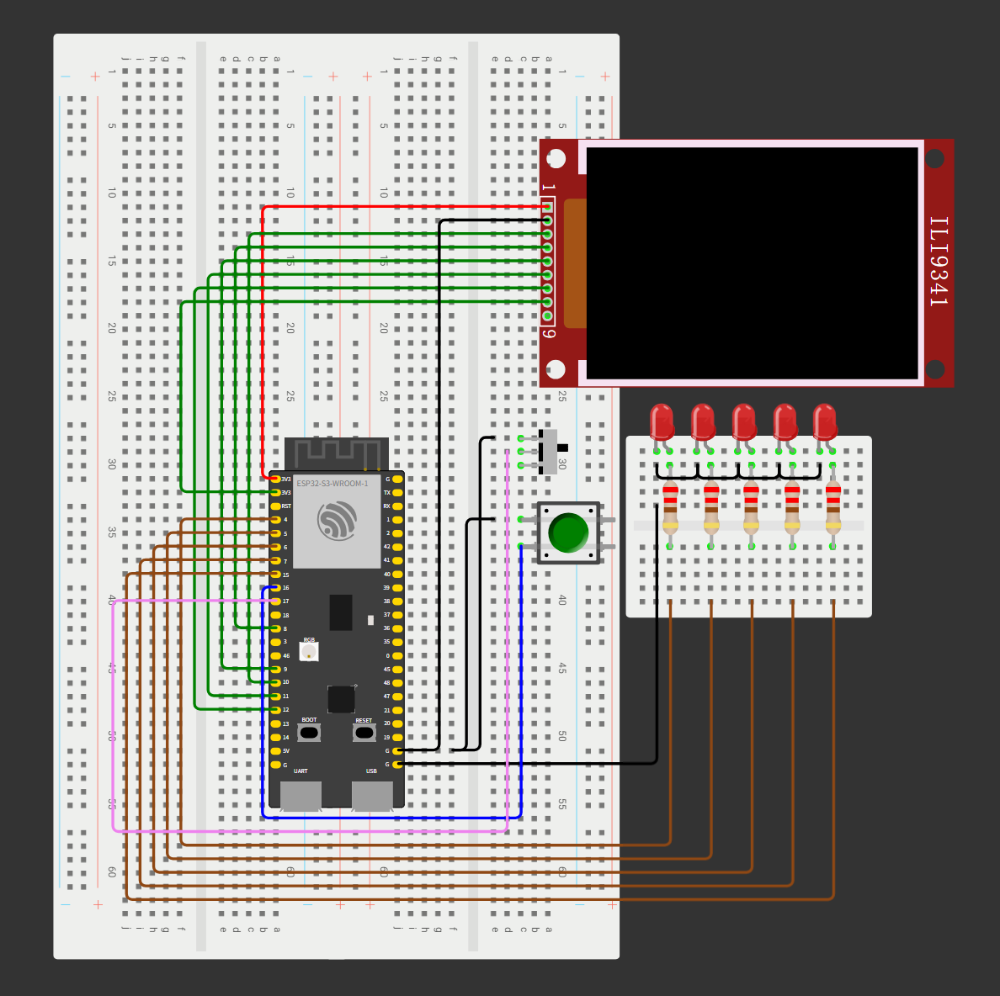
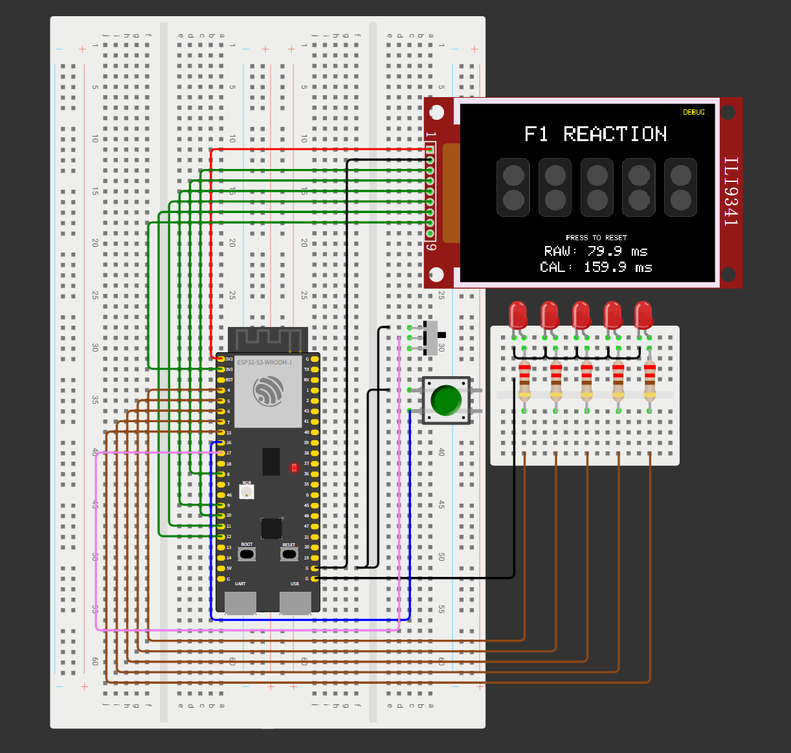

# ESP32 F1 反应游戏

[English](README.md) | **简体中文**

**基于 ESP32-S3、ILI9341 TFT 显示屏和五颗外部红色 LED 的 F1 风格反应游戏。**

启动一轮游戏，等待红灯依次点亮，在外部 LED 熄灭后立即按下按钮。程序测量反应时间、检测抢跑，并保持成绩显示，直到手动复位。

[运行 Wokwi 项目](https://wokwi.com/projects/479746846531493889) · [硬件笔记（英文）](docs/hardware-notes.md) · [参考资料（英文）](docs/references.md)

**当前状态：** 最新代码已通过使用者反馈的功能测试。具体测试环境和依赖版本尚未记录，实物计时的独立校准仍待完成。

## 项目预览

### 电路图



### 游戏画面



图片用于展示项目，可能尚未包含最新的屏幕提示。运行在线仿真前，请确认其中的程序与本仓库当前的 `sketch.ino` 一致。

## 功能特点

- 五颗 GPIO 控制的外部 LED，按 800 ms 的间隔依次点亮
- 第五颗 LED 点亮后，随机等待 1–3 秒再熄灯
- 320 × 240 TFT 界面，包含五组双排灯箱，上排始终为灰色
- 通过中断保存按键时间戳，以毫秒显示原始反应时间
- 抢跑检测及 10 秒反应截止时间
- Debug 和 Normal 两种模式，每轮开始时锁定模式
- 同时记录按下与松开边沿，屏幕更新期间也能跟踪释放抖动
- 使用同一个按钮，分别完成开始、反应和复位操作
- 可配置计时补偿，通过 115200 波特率串口输出结果
- 复位时局部刷新显示，减少全屏闪烁

## 游戏方法

1. 用滑动开关选择 **Debug（调试）** 或 **Normal（正常）** 模式，待开关状态稳定后再开始。
2. 松开按钮，然后按下一次，启动新一轮游戏。
3. 松开按钮，等待五颗外部红色 LED 依次点亮。
4. 全部点亮后，继续等待随机延迟结束。
5. **观察外部 LED，在它们熄灭后立即按下按钮。**
6. 查看成绩，松开按钮，再按一次复位。
7. 再按一次，启动下一轮。

计时以外部 LED 熄灭为基准。TFT 上的灯和 `GO!` 提示随后才通过 SPI 更新；如果观察屏幕作出反应，成绩可能额外包含显示延迟。界面中的 `WATCH PHYSICAL LEDS` 表示“请观察外部 LED”。

| 显示结果 | 含义 | 下一步 |
|---|---|---|
| 反应时间 | 在 10 秒截止时间之前收到有效按键 | 松开，再按一次复位 |
| `FALSE START!` | 熄灯前按键，或熄灯时仍按住按钮，即抢跑 | 松开，再按一次复位 |
| `TIMEOUT!` | 截止时间前没有有效反应；恰好 10 秒也视为超时 | 松开，再按一次复位 |

程序不会自动复位，也不会自动开始下一轮。结果页或复位画面绘制完成后，按钮必须连续松开至少 30 ms，才会接受下一次按下。结果页绘制期间的按键会被丢弃；持续按住按钮不会重复触发功能。上电时如果按住按钮，应先松开，再尝试开始。

## 运行模式

| 模式 | 开关输入 | 显示行为 |
|---|---|---|
| Debug（调试） | GPIO17 为 LOW | 反应阶段约每 100 ms 更新一次 `RAW` 和 `CAL`，按下后保持最终值 |
| Normal（正常） | GPIO17 为 HIGH | 不显示实时计时，有效按下后显示补偿成绩 |

`RAW` 是未补偿的时间戳差值，`CAL` 是补偿后的结果。游戏中途切换开关不会改变当前轮次的模式；需要先复位，再按新选择开始。

## 硬件与接线

仿真使用 ESP32-S3-DevKitC-1。计划使用的实物板为商家提供的 N16R8 版本，标称 16 MB Flash、8 MB PSRAM；使用前应核对模块丝印、板卡版本、引脚及配置。

| 元件 | 数量 |
|---|---:|
| ESP32-S3 开发板 | 1 |
| ILI9341 2.8 英寸 SPI TFT 模组 | 1 |
| 红色 LED | 5 |
| 220 Ω LED 串联电阻 | 5 |
| 瞬时按键 | 1 |
| 滑动开关 | 1 |
| 面包板、杜邦线和 USB 线 | 按需 |

### TFT 显示屏

| TFT 引脚 | ESP32-S3 接线 |
|---|---|
| VCC | 仿真中接 3V3 |
| GND | GND |
| CS | GPIO10 |
| RST | GPIO8 |
| D/C | GPIO9 |
| MOSI | GPIO11 |
| SCK | GPIO12 |
| LED / 背光 | 仿真中接 3V3 |
| MISO | 未使用 |

连接实物模组时，应根据对应资料核对供电要求、背光电流、稳压器及焊接跳线配置。仿真中的供电接法不能代替对实际板卡的检查。

### 外部 LED

| LED | GPIO | 串联电阻 |
|---|---|---|
| 1 | GPIO4 | 220 Ω |
| 2 | GPIO5 | 220 Ω |
| 3 | GPIO6 | 220 Ω |
| 4 | GPIO7 | 220 Ω |
| 5 | GPIO15 | 220 Ω |

每颗 LED 使用独立的串联电阻，LED 阴极连接公共地。

### 按钮与模式开关

| 控件 | 接线 |
|---|---|
| 反应按钮 | 按下时将 GPIO16 接到 GND |
| 模式开关 | 公共端接 GPIO17，一侧接 GND，另一侧悬空 |

两个输入均启用内部上拉。开发板、显示屏及控件需要共地。

## 运行项目

### Wokwi 仿真

1. 打开 [Wokwi 仿真](https://wokwi.com/projects/479746846531493889)。
2. 对照本仓库检查在线代码，必要时更新。修改本地 Git 文件不会自动更新该 Wokwi 项目。
3. 启动仿真、选择模式，再按上述方法操作。
4. 以仿真中的五颗外部 LED 作为起跑信号。

`diagram.json` 保存电路连接，`libraries.txt` 列出显示库依赖。

### ESP32-S3 实物

1. 安装 Arduino IDE 和 Espressif ESP32 开发板包。
2. 安装 **Adafruit GFX Library**、**Adafruit ILI9341** 及其所需依赖。
3. 将 `sketch.ino` 放入与文件同名的 Arduino 草图文件夹，或打开时由 Arduino IDE 创建匹配的文件夹。
4. 选择与实际模块匹配的开发板、Flash/PSRAM 设置及 USB 端口。
5. 通电前检查接线、供电及显示模组配置。
6. 编译并上传。以 **115200 波特率**打开串口监视器，查看有效成绩、抢跑和超时信息。
7. 记录成功编译时使用的开发板包和库版本。宣称计时精度前，应进行独立校准。

程序依赖 ESP32 Arduino 环境，使用其中的 GPIO 中断和 FreeRTOS 临界区机制。目前尚未固定依赖版本。

## 计时与配置

程序关闭五颗外部 LED 后，立即通过 `micros()` 记录 `lightsOutUs`；接受按键时，中断保存 `pressTimeUs`。反应时间来自这两个时间戳，而不是主循环完成显示更新的时刻。

```text
原始时间 raw_ms = (press_time_us - lights_out_us) / 1000
最终时间 final_ms = max(0, raw_ms × TIME_MULTIPLIER - FIXED_COMPENSATION_MS)
```

`sketch.ino` 开头的当前配置：

| 常量 | 当前值 | 用途 |
|---|---|---|
| `TIME_MULTIPLIER` | `1.0f` | 缩放原始时间 |
| `FIXED_COMPENSATION_MS` | `-80.0f` | 减去固定偏移；当前负值实际让成绩**增加 80 ms** |
| `LIGHT_INTERVAL_MS` | `800` | 下一颗 LED 点亮前的标称间隔 |
| `WAIT_MIN_MS` | `1000` | 第五颗 LED 点亮后的最短随机等待 |
| `WAIT_MAX_MS` | `3000` | 最长随机等待，包含此上限 |
| `REACTION_TIMEOUT_US` | `10000000UL` | 反应截止时间，单位为微秒 |
| `DEBUG_REFRESH_MS` | `100` | 实时计时显示的标称刷新间隔 |
| `BUTTON_RELEASE_MS` | `30` | 再次接受按键前要求的连续松开时间 |
| `MODE_DEBOUNCE_MS` | `40` | 模式开关消抖时间 |

例如原始时间为 **200 ms** 时，当前补偿结果为 **280 ms**。如果要关闭补偿，将 `TIME_MULTIPLIER` 设为 `1.0f`，将 `FIXED_COMPENSATION_MS` 设为 `0.0f`。

现有偏移值用于实验，并不是经测量得出的通用 TFT 延迟修正值。使用微秒时间戳、显示一位小数，并不代表具有同等测量精度。中断延迟、LED 逐个关闭、屏幕响应及仿真时序仍会影响系统；实物校准需要独立的时间参考。

## 程序结构

| 状态 | 职责 |
|---|---|
| `ST_IDLE` | 等待手动开始 |
| `ST_LIGHTING` | 依次点亮五颗 LED |
| `ST_WAIT` | 随机等待期间保持红灯亮起 |
| `ST_REACTION` | 接受带时间戳的反应按键，或到达截止时间 |
| `ST_RESULT` | 保持成绩、抢跑或超时画面，等待复位 |

`CHANGE` 中断同时跟踪按下和松开边沿，包括 TFT 绘图期间的释放抖动。每次允许触发后，仅保留第一次按下事件。主循环在按钮稳定松开后重新允许触发；中断和主循环通过同一个临界区锁保护事件与时间戳。

超时边界附近，已经记录的按键按原始时间戳判断。如果没有待处理事件，程序会原子地关闭输入，再显示超时。切换到结果页时会清除旧事件，复位前必须重新确认稳定松开。

复位只重绘发生变化的区域，标题、灯框及上排灰灯保持不变。

## 验证状态

- 最新版本已通过使用者反馈的功能测试。
- 补充的桌面检查已通过 32 项断言，覆盖绘图期间消抖、持续按住、超时边界、时间戳回绕、模式锁定及完整游戏流程。检查使用模拟硬件接口，不能代替 ESP32 目标编译或实物测量。
- 使用者的具体测试平台、开发板版本、依赖版本和独立校准数据尚未记录。

修改程序后，可重点检查提前按键、持续按住直到熄灯、反复释放抖动、两种模式、截止前瞬间按键、超时后复位，以及连续多轮游戏。

## 仓库结构

```text
ESP32-F1-Reaction-Game/
├── sketch.ino
├── diagram.json
├── libraries.txt
├── wokwi-project.txt
├── README.md
├── README.zh-CN.md
├── LICENSE
├── images/
│   ├── circuit.png
│   └── gameplay.png
└── docs/
    ├── hardware-notes.md
    └── references.md
```

[硬件笔记（英文）](docs/hardware-notes.md) 保存接线记录及待完成的实物检查。[参考资料（英文）](docs/references.md) 链接上游开发板、面板和控制器文档。当前目录不重新分发商家 PDF 资料包和软件安装程序；旧提交仍可能包含此前的资料。

## 后续计划

- 记录可复现的 ESP32 编译环境及详细测试结果
- 测量并校准实物输入和视觉信号的时序
- 更新截图，使其与最新界面一致
- 增加最佳成绩记录和多轮统计
- 进一步优化显示，制作实物外壳

## 许可证

项目原创代码和文档采用 [MIT 许可证](LICENSE)。第三方库、datasheet、工具和其他被引用资料保留各自的许可证及版权声明。
